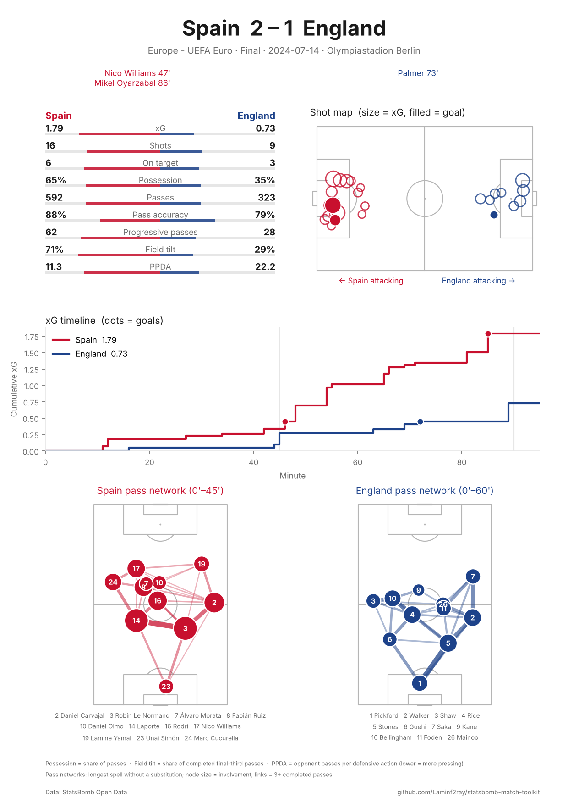
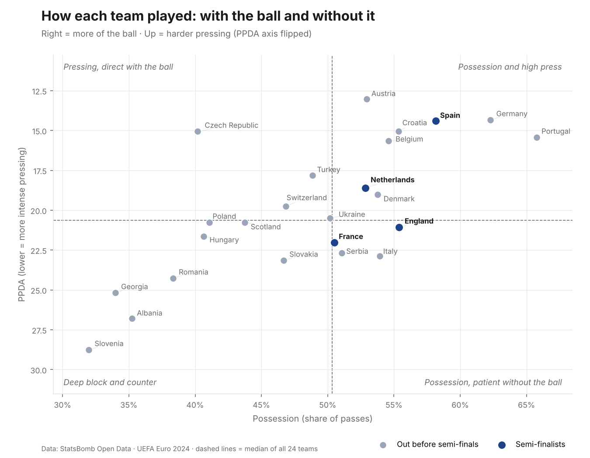

# StatsBomb Match & Team Analysis Toolkit

A reproducible Python and SQL pipeline for football event data, with automated match reports and team style profiles. It uses StatsBomb Open Data for UEFA Euro 2024 (51 matches, about 188,000 events).

*Independent portfolio project.*

## What it does

| Stage | Status | Output |
|---|---|---|
| 1. Pipeline: download, clean and load event data into DuckDB, then check it | ✅ Done | `data/football.duckdb` |
| 2. Automated post-match report: shot map, xG timeline, pass networks, key stats | ✅ Done | `outputs/reports/` |
| 3. Team style profiles: pressing, possession, chance quality for all 24 teams | ✅ Done | `outputs/profiles/`, [write-up](docs/team_styles.md) |
| 4. Ad-hoc analysis questions, written up | ⏳ Planned | `docs/` |

## Quick start

```bash
git clone https://github.com/Laminf2ray/statsbomb-match-toolkit.git
cd statsbomb-match-toolkit
python -m venv .venv
source .venv/bin/activate          # Windows: .venv\Scripts\activate
pip install -r requirements.txt

python src/pipeline.py             # all Euro 2024 matches, about 2 minutes on first run
python src/pipeline.py --limit 5   # quick test

python src/match_report.py --list            # match IDs
python src/match_report.py                   # report for the most recent match (the final)
python src/match_report.py --match 3943043   # a specific match
python src/match_report.py --all             # all 51 matches, about 1.5 minutes

python src/team_profiles.py                  # style maps + a profile page per team
```

Downloads are cached in `data/raw/`, so later runs take seconds. To load another competition, find its IDs with `statsbombpy.sb.competitions()` and pass them in, for example `--competition 43 --season 106` for the 2022 World Cup.

## Example: automated match report

One command produces a one-page A4 report (PDF and PNG) for any match:



[PDF version](docs/example_report_euro2024_final.pdf)

**What's on the page**
- **Key stats:** xG, shots, shots on target, possession, passing accuracy, progressive passes, field tilt and PPDA
- **Shot map:** every shot, sized by xG, with goals filled in
- **xG timeline:** cumulative xG for both teams, with goals marked
- **Pass networks:** average positions and passing links for each team, using the longest spell without a substitution or red card, so an early injury doesn't leave only a few minutes of data
- Scorers include penalties and own goals; extra time is handled

## Example: team style profiles

`src/team_profiles.py` compares all 24 teams on 10 metrics (per 90 minutes) and places each one on two maps. [Read the write-up](docs/team_styles.md).



**Findings**
- Possession and pressing went together (correlation −0.72 between possession and PPDA).
- Spain, Portugal and Germany all combined possession, pressing and few chances conceded; Spain also led for high regains and won all 7 matches.
- England reached the final with the 19th-highest chance creation of 24 teams, built on a strong defence.

## Data model

**Tables**
- `matches`: one row per match (teams, score, date, stage, stadium)
- `events`: one row per on-ball event (passes, shots, carries, pressures and so on), with coordinates flattened into numeric `x`/`y` columns

**Views** (`sql/views.sql`)
- `shots`: shots with xG, outcome, body part and location
- `passes`: passes with completion, **progressive** and **into-final-third** flags
- `team_match_summary`: team totals per match, covering shots, goals, xG, passes, completion, progressive passes and **field tilt**

Coordinates use StatsBomb's 120 × 80 pitch. Every team attacks left to right. Penalty shoot-outs are excluded.

## Data quality checks

Every pipeline run checks that:
- each match has event data
- goals counted from the event data (shots plus own goals) equal the final score for every match

## Example: the Euro 2024 final

```sql
SELECT team, shots, goals, xg, pass_completion, progressive_passes, field_tilt
FROM team_match_summary
WHERE match_date = (SELECT MAX(match_date) FROM matches);
```

| team | shots | goals | xg | pass completion | progressive passes | field tilt |
|---|---|---|---|---|---|---|
| Spain | 16 | 2 | 1.79 | 87.5% | 62 | 71% |
| England | 9 | 1 | 0.73 | 78.6% | 28 | 29% |

## Metric definitions

- **xG (expected goals):** StatsBomb's estimate of the probability that a shot is scored.
- **Progressive pass:** a completed pass, starting outside the team's own defensive third, that moves the ball at least 25% closer to the opponent's goal line.
- **Field tilt:** a team's share of the completed final-third passes in a match, used as a measure of territorial dominance.
- **Possession (report):** a team's share of the match's passes. This is a common proxy; StatsBomb doesn't publish a possession percentage.
- **PPDA (passes per defensive action):** opponent passes in their own 60% of the pitch, divided by the team's tackles, interceptions and fouls in that zone. Lower means more intense pressing.

## Project structure

```
statsbomb-match-toolkit/
├── src/
│   ├── pipeline.py      # ingestion, cleaning, checks, load
│   ├── match_report.py  # one-page match reports
│   └── team_profiles.py # team style maps and profiles
├── sql/views.sql        # analysis views
├── notebooks/           # exploration and team profiles
├── docs/                # example report and write-ups
├── data/                # created by the pipeline, not committed
├── requirements.txt
└── README.md
```

## Data source

Data provided by [StatsBomb Open Data](https://github.com/statsbomb/open-data). This project follows StatsBomb's open data terms: please credit StatsBomb wherever the data or outputs are published.
