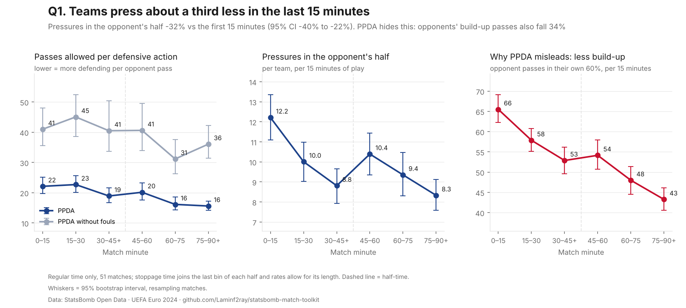
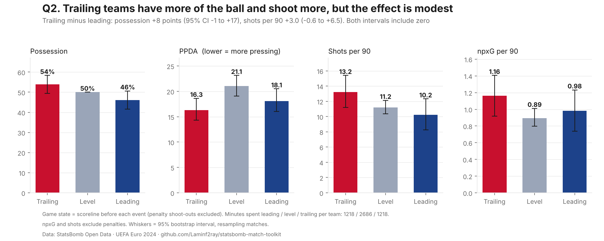
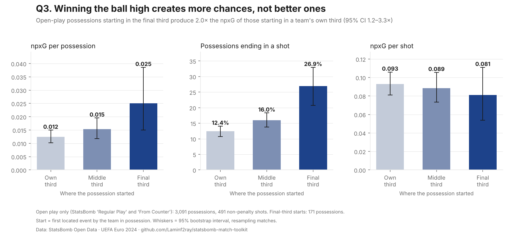

# Three questions about Euro 2024

Each question is answered with the event data from all 51 matches, a chart and a 95% confidence interval. Code: [`src/questions.py`](../src/questions.py). Every number below is in [`results.json`](questions/results.json).

| Question | Answer |
| --- | --- |
| 1. Does pressing fade as matches go on? | **Yes.** Teams make 32% fewer pressures in the opponent's half in the last 15 minutes than in the first 15. PPDA hides this. |
| 2. Does the scoreline change how teams play? | **Probably, but the effect is modest.** Trailing teams had 8 points more possession and 3 more shots per 90 than leading teams, but both intervals include zero. |
| 3. Do high regains lead to better chances? | **More chances, not better ones.** Possessions won in the final third end in a shot twice as often, but each shot is no better. |

**How the intervals work.** A 95% confidence interval (CI) is the range the true value probably lies in, given how much the results vary between matches. Each one comes from a bootstrap: the analysis is rerun 2,000 times on random resamples of the 51 matches. Whole matches are resampled because events within a match aren't independent; resampling individual events would make the intervals look narrower than they should.

---

## 1. Does pressing fade as matches go on?

**Yes, by about a third.** Teams made 12.2 pressures in the opponent's half per 15 minutes at the start of matches and 8.3 in the last 15: a fall of 32% (95% CI 22% to 40%).

**PPDA tells the opposite story, and it's misleading here.** PPDA falls from 22 to 16, which normally means *more* pressing. It falls because the other side of the ratio changes: opponents make 34% fewer build-up passes in their own 60% of the pitch late on (66 to 43 per 15 minutes). With fewer passes to count, the ratio drops even though the press has eased.

**What I checked along the way**
- My first version counted pressures per 15-minute block without adjusting for stoppage time, which makes the last block longer. That inflated late-game counts: it suggested fouls rose by 55%. Measured per minute of play, the change in fouls is +10% (95% CI −5% to +31%), which is no clear change.
- Removing fouls from PPDA leaves a smaller fall (−12%, CI −28% to +7%), so part of PPDA's drop is fouls and part is the build-up effect.

**Limits.** Substitutions, tiredness and the scoreline all change late in matches, so this shows *what* happens, not *why*. Pressures are StatsBomb's on-ball pressure events, not a full measure of off-ball pressing.

---

## 2. Does the scoreline change how teams play?

**The direction matches football intuition, but 51 matches aren't enough to be sure.** "Game state" means whether a team is leading, level or trailing at the moment of each event. Teams spent 1,218 minutes leading, 2,686 level and 1,218 trailing.

| Trailing minus leading | Difference | 95% CI |
| --- | --- | --- |
| Possession | +7.7 points | −1.3 to +16.7 |
| Shots per 90 | +3.0 | −0.6 to +6.5 |
| npxG per 90 | +0.18 | −0.23 to +0.59 |
| PPDA | −1.8 (more pressing) | −5.2 to +1.8 |

Every interval includes zero, so none of these differences is clearly established on its own. Together they point the same way: trailing teams take more of the ball and push for chances, and leading teams sit deeper.

**A confounder to flag.** Both leading and trailing teams press more than level teams (PPDA 18.1 and 16.3 vs 21.1). That's probably because most matches are level early on, and Question 1 shows PPDA falls later in matches regardless of score. Game state and match time are tangled together. A fairer test would compare states within the same period of a match, which needs more matches than one tournament provides.

---

## 3. Do high regains lead to better chances?

**Winning the ball high produces more chances, not better ones.** This uses 3,091 open-play possessions (set pieces excluded), grouped by where each started.

| Where the possession started | Possessions | Ended in a shot | npxG per possession | npxG per shot |
| --- | --- | --- | --- | --- |
| Final third | 171 | 26.9% | 0.025 | 0.081 |
| Middle third | 1,169 | 16.0% | 0.015 | 0.089 |
| Own third | 1,751 | 12.4% | 0.012 | 0.093 |

- Possessions starting in the final third produce **2.0× the npxG** of those starting in a team's own third (95% CI 1.2–3.3×). The interval is above 1, so this difference is well supported.
- That comes from **shot frequency**: 27% end in a shot, against 12%.
- **Shot quality isn't higher** (0.081 vs 0.093 npxG per shot, with overlapping intervals). Winning the ball near goal often leads to a quick, hurried shot rather than a clear chance.

**Limits.** Only 171 possessions started in the final third, so that bar has a wide interval. "Start" is the first event with a location by the team in possession, which is usually, but not always, where it won the ball.

---

## What this shows about method

- **Check the metric before trusting it.** PPDA pointed the wrong way for Question 1 because its denominator changed. Splitting a ratio into its parts showed what was really happening.
- **Normalise by exposure.** Counting events in unequal time blocks produced a false finding about fouls.
- **Report uncertainty, including "not proven".** Question 2's differences are plausible but not established, and saying so is the honest result.

*Data: StatsBomb Open Data.*
