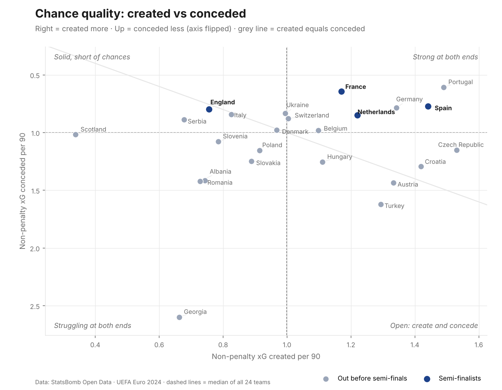
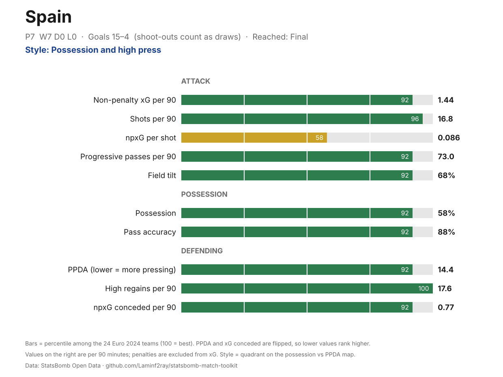
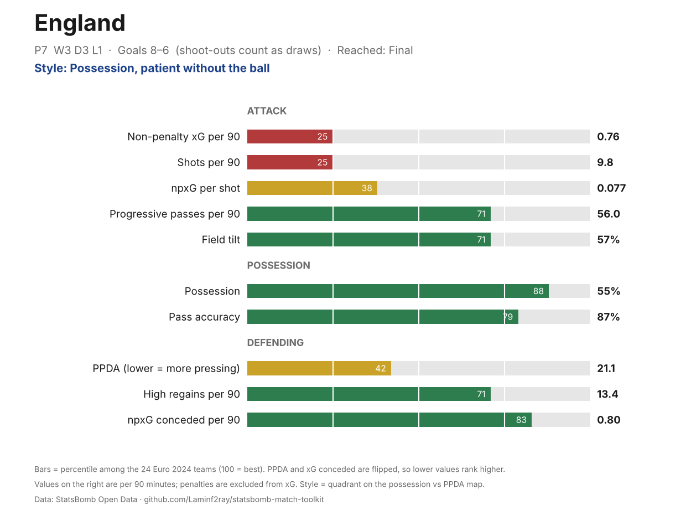

# Euro 2024 team styles

Spain, Portugal and Germany all dominated the ball, pressed hard and limited chances. Spain went further by winning the ball back high more than anyone (17.6 times per 90) and turning chances into goals: 14 non-penalty goals from 10.6 npxG, plus an own goal. They won all 7 matches. The other finalist, England, got there on defence: they had the 19th-highest chance creation of the 24 teams.

All figures are per 90 minutes across the whole tournament, with extra time included and penalty shoot-outs excluded. Non-penalty xG (npxG) leaves out penalties, which are worth about 0.78 xG each and would distort chance creation. Code: [`src/team_profiles.py`](../src/team_profiles.py). Full table: [`team_metrics.csv`](team_styles/team_metrics.csv).

## How teams played

**Possession and pressing went together.** Teams that had more of the ball also pressed harder: the correlation between possession and PPDA is −0.72 (lower PPDA means more pressing). Teams that keep the ball tend to lose it higher up the pitch, so they press to win it straight back.

The exceptions are worth noting:
- **Czech Republic** pressed as hard as Croatia (PPDA 15.1) with only 40% possession: aggressive without the ball, direct with it.
- **England, France and Italy** had more than half the ball but pressed less than the median: patient, mid-block defending.
- **Slovenia, Albania and Georgia** sat deepest: 32–35% possession and the least pressing.

## Chances created and conceded

Teams above the grey line created more than they conceded.

| Team | npxG per 90 | npxG conceded per 90 | Goals for–against | What stands out |
| --- | --- | --- | --- | --- |
| Spain | 1.44 | 0.77 | 15–4 | 14 non-penalty goals from 10.6 npxG, plus an own goal. Won all 7. |
| Portugal | 1.49 | 0.61 | 5–3 | Best defence and 2nd-best attack, but only 3 non-penalty goals of their own from 8.4 npxG. |
| France | 1.17 | 0.64 | 4–3 | 2nd-best defence. Of 4 goals, 1 was open play, 1 a penalty and 2 own goals, from 7.4 npxG. |
| England | 0.76 | 0.80 | 8–6 | 19th of 24 for chance creation, but 7 non-penalty goals from 5.8 npxG, plus a penalty. |
| Georgia | 0.66 | 2.60 | 5–8 | Conceded far more than anyone, yet reached the round of 16. |

## Team profiles

Every team has a one-page percentile profile in `outputs/profiles/teams/`. Spain rank in the top 10% of teams on 9 of the 10 metrics. England's profile shows the trade-off: strong possession and defending, weak shot volume and quality.

## Limitations

- **Small samples.** Teams played 3 to 7 matches, so one game can move a team's numbers a lot.
- **No adjustment for opponents.** A group-stage team that played Spain looks worse than one that played weaker sides.
- **Game state.** Teams that lead often sit back, which lowers their possession and pressing without reflecting their plan.
- **Possession is a proxy** (share of passes). Field tilt follows it closely at tournament level (correlation 0.92), so the two say similar things here.
- **Goals vs xG over a few matches** mostly reflects finishing variance and luck, not a repeatable skill.

*Data: StatsBomb Open Data.*
